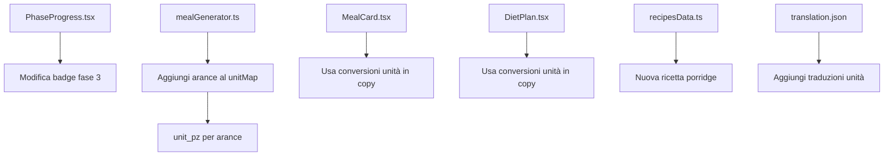

# Piano di Implementazione - Aggiornamenti Richiesti

## Stato Attuale

### ✅ Completato
1. **Aggiunta conversioni unità per i lamponi (foodId '53')**
   - `snapToWholeUnits`: `{ unit: 'pz', unitGrams: 20, min: 1, max: 3 }`
   - `getUnitGrams`: 20
   - `getUnitType`: 'pz'
   - Correzione traduzione italiana "Raspberries" -> "Lamponi"
   - Tutti i 145 test passati

## Nuovi Task Richiesti

### 1. Fase 3 Badge Personalizzazione
**File:** `src/components/dietPlan/PhaseProgress.tsx`

**Richiesta:** In fase 3, mostrare prima il numero del giorno e poi "giorni dall'inizio fase 0" (in ordine inverso rispetto alla logica corrente).

**Logica corrente** (righe 108-112):
```
isPreStart ? preStartDaysFromPhase0 : currentPhaseDayNumber
```

**Logica richiesta per fase 3:**
- Mostrare: `${currentPhaseDayNumber} giorni dall'inizio fase 0`

### 2. Formattazione Porzioni - Unità di Misura

**File:** `src/utils/mealGenerator.ts` - Funzioni `snapToWholeUnits`, `getUnitGrams`, `getUnitType`

#### Alimenti che richiedono modifica:

| FoodId | Alimento | Configurazione Attuale | Richiesta |
|--------|----------|----------------------|-----------|
| '3' | Avena in fiocchi | grammi | Mantieni grammi |
| '13' | Uova | `{ unit: 'uova', unitGrams: 50, min: 2, max: 4 }` | ✅ Già configurato per numero di uova |
| '15' | Arance | grammi | Configurare per numero di arance |
| '39' | Semi di Chia | `{ unit: 'cucchiai', unitGrams: 12, min: 1, max: 2 }` | ✅ OK |
| - | Acqua | grammi | ✅ OK (acqua e avena sono correlate) |
| '57' | Tempeh | `{ unit: 'pz', unitGrams: 100, min: 1, max: 2 }` | ✅ Già configurato |
| '29' | Banana | `{ unit: 'pz', unitGrams: 120, min: 1, max: 3 }` | ✅ Già configurato |
| '53' | Lamponi | `{ unit: 'pz', unitGrams: 20, min: 1, max: 3 }` | ✅ Appena completato |
| '3' | Quinoa | grammi | Mantieni grammi (l'utente dice "non ha senso la precisione al grammo") |
| '35' | Tofu | `{ unit: 'pz', unitGrams: 150, min: 1, max: 2 }` | ✅ Già configurato |
| '19' | Spinaci | grammi | ✅ OK |
| '68' | Noci | `{ unit: 'pz', unitGrams: 5, min: 2, max: 8 }` | ✅ Già configurato |

**Aggiornamenti necessari:**
- **Arance ('15')**: Configurare con unità `pz`, unitGrams: 150-180g per persona

### 3. Ricetta Porridge Personalizzata

**File:** `src/utils/recipesData.ts`

**Richiesta:** Creare una ricetta "porridge d'acqua, arance e semi di chia" che riconosca automaticamente gli ingredienti di colazione.

**Opzioni:**
1. Creare una nuova ricetta custom
2. Modificare la ricetta esistente "Porridge di Avena con Frutti di Bosco e Mandorle"

**Proposta:** Creare una ricetta custom condivisa come "Porridge d'Avena con Acqua, Arance e Semi di Chia"

### 4. Aggiornamento Pulsanti Copia

**File:** 
- `src/components/dietPlan/MealCard.tsx` (linee 80-99)
- `src/components/DietPlan.tsx` (linee 148-191)

**Richiesta:** Aggiornare `handleCopyMeal` e `handleCopyAllMeals` per:
1. Usare le conversioni unità invece di mostrare solo grammi
2. Arrotondare i valori (es. 150.3g -> 150g)

**Codice corrente in MealCard.tsx:**
```javascript
const unitStr = p.unit && p.unitValue
  ? `${formatNum(p.unitValue)} ${t(`unit_${p.unit}`)}`
  : `${formatNum(p.grams)} ${t('unit_grams')}`;
```

**Codice corrente in DietPlan.tsx:**
```javascript
fullText += `  - ${p.foodName}: ${formatNum(p.grams)}g\n`;
```

### 5. Traduzioni Unità

**File:** `public/locales/it/translation.json`

Verificare se esistono traduzioni per:
- `unit_uova` (filetto)
- `unit_vasetti` (vasetti)
- `unit_quadrati` (quadrati)
- `unit_cucchiai` (cucchiai)
- `unit_fette` (fette)
- `unit_pz` (pz - già esiste come `shopping_unit_pcs`)

---

## Diagramma delle Modifiche



## Ordine di Esecuzione

1. ✅ Aggiungere lamponi al database conversioni
2. ✅ Correggere traduzione italiana lamponi
3. ⏳ Aggiungere arance ('15') al unitMap
4. ⏳ Modificare logica display badge in PhaseProgress.tsx
5. ⏳ Aggiornare handleCopyMeal (MealCard.tsx)
6. ⏳ Aggiornare handleCopyAllMeals (DietPlan.tsx)
7. ⏳ Creare ricetta porridge personalizzata
8. ⏳ Aggiungere traduzioni unità mancanti
9. ⏳ Eseguire test di verifica

## Note Tecnici

### Tipi Unità Esistenti
```typescript
export type FoodUnit = 'g' | 'uova' | 'vasetti' | 'quadrati' | 'cucchiai' | 'fette' | 'pz';
```

### FoodId Alimenti di Interesse
- '13': Uova → unit: 'uova', unitGrams: 50
- '15': Arance → da configurare
- '29': Banana → unit: 'pz', unitGrams: 120
- '35': Tofu → unit: 'pz', unitGrams: 150
- '38': Mandorle → unit: 'pz', unitGrams: 1
- '53': Lamponi → unit: 'pz', unitGrams: 20 ✅ APPENA FATTO
- '57': Tempeh → unit: 'pz', unitGrams: 100
- '68': Noci → unit: 'pz', unitGrams: 5

### Stima Peso Arance
Un'arancia media è di circa 150-180g. Si consiglia:
- unit: 'pz'
- unitGrams: 150
- min: 1, max: 2 (per porzione di colazione)