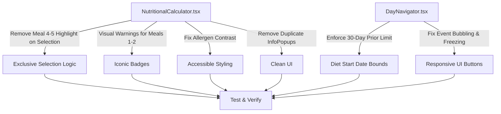

# Plan: Additional UI Fixes and Refinements

## Objectives
1. **NutritionalCalculator Refinements**:
   - Remove highlighting for meals 4 and 5 when they overlap with the current meal selection in [`src/components/NutritionalCalculator.tsx`](src/components/NutritionalCalculator.tsx:369).
   - Ensure that only one recommended meal can be selected at a time (and clarify selection exclusivity logic in [`src/components/NutritionalCalculator.tsx`](src/components/NutritionalCalculator.tsx:371)).
   - Display warnings for meals 1 and 2 in a visual, non-textual manner (e.g. warning icon/indicator badge rather than verbose text) in [`src/components/NutritionalCalculator.tsx`](src/components/NutritionalCalculator.tsx:360).
   - Fix allergen selection color contrast in [`src/components/NutritionalCalculator.tsx`](src/components/NutritionalCalculator.tsx:431).
   - Eliminate duplicate [`InfoPopup`](src/components/InfoPopup.tsx:1) components while preserving multilingual support.

2. **DayNavigator Refinements**:
   - Prevent users from selecting a date that is more than 30 days before the diet start date in [`src/components/DayNavigator.tsx`](src/components/DayNavigator.tsx:107) and [`src/hooks/useDietPlan.ts`](src/hooks/useDietPlan.ts:573).
   - Resolve interface freeze and ensure all UI buttons remain responsive across [`src/components/DayNavigator.tsx`](src/components/DayNavigator.tsx:1).

3. **Verification & Delivery**:
   - Run test suite and check translation keys (`npm test && node check_keys.cjs`).
   - Commit and push changes.

## Mermaid Architecture Diagram

