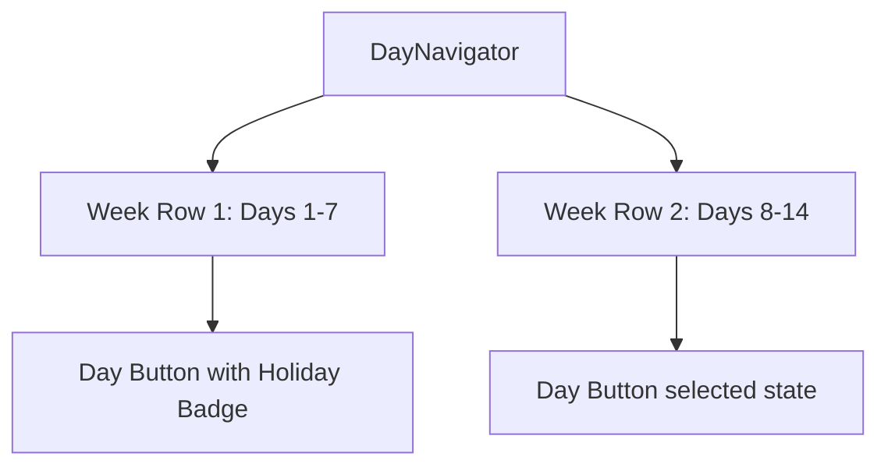

# DietPlan & DayNavigator Redesign Plan

## Overview
This plan outlines the architectural changes to improve the Diet Plan module in FoodMapper:
1. **DayNavigator Week-per-Row Grid & Holiday Highlighting**: Render days organized by weeks (1 week per row), clearly highlighting holidays (`festivi`) and removing UI redundancy (such as redundant date pickers/calendar dropdowns).
2. **Meal Count Extension (1 to 7 meals)**: Expand user preferences and meal generation from fixed 3 or 4 meals to any number from 1 to 7 meals per day, with digestive/nutritional risk warnings for extreme selections (1, 2, 6, 7 meals).
3. **DietPlan Header Layout**: Align the meal count selector side-by-side with the calculator and diary buttons.
4. **InfoPopup Audit & Refinement**: Audit and rewrite convoluted, generic, or poorly formatted info popups across localization files (`it`, `en`, `de`, `fr`, `es`).

---

## Architecture & Components

### 1. DayNavigator (`src/components/DayNavigator.tsx`)
- **Structure**: Group days into week chunks (7 days per row: Week 1, Week 2, etc.).
- **Holiday Highlighting**: Check each day against Italian/international holidays and apply distinct styling (e.g., red/festive border or badge).
- **Redundancy Removal**: Remove the native `<input type="date">` and redundant date picker UI elements, replacing them with a clean week-row button grid where clicking any day card instantly navigates to that day.

### 2. Meal Count Extension & Warnings (`src/types/dietPlan.ts`, `src/utils/mealGenerator.ts`, `src/hooks/useDietPlan.ts`, `src/components/DietPlan.tsx`)
- **Type Update**: Update `mealCount` preference type from `3 | 4` to `1 | 2 | 3 | 4 | 5 | 6 | 7`.
- **Dynamic Meal Generation**:
  - Extend meal keys (`colazione`, `pranzo`, `spuntino`, `cena`, `merenda`, `pre- nanna`, `brunch`, etc.) and proportional calorie/protein share distributions dynamically for 1 to 7 meals.
- **Risk Warnings**: When user selects 1, 2, 6, or 7 meals, display an inline warning toast or alert regarding digestive load (e.g. too few meals causing large glycemic spikes or too many meals causing constant digestion).

### 3. InfoPopup Audit & Localization (`src/utils/infoPopups.ts`, `public/locales/*/translation.json`)
- Review all keys under `info.` in translation files (`it`, `en`, `de`, `fr`, `es`).
- Rewrite verbose, overly generic, or confusing descriptions into concise, professional, and well-formatted HTML/text strings explaining the specific metric or feature.

---

## Implementation Steps Checklist
1. Update types (`src/types/dietPlan.ts`) for `mealCount` (`1 | 2 | 3 | 4 | 5 | 6 | 7`).
2. Update meal generation logic (`src/utils/mealGenerator.ts`) to handle 1 to 7 meals with appropriate macro distribution shares and meal keys.
3. Redesign `DayNavigator` (`src/components/DayNavigator.tsx`) to show 1 week per row, highlight holidays, and remove redundant date picker inputs.
4. Update `DietPlan` header layout (`src/components/DietPlan.tsx`) to place the 1-7 meal count selector side-by-side with action buttons and add warning alerts for extreme meal counts.
5. Audit and polish info popup texts in translation files (`public/locales/*/translation.json`).
