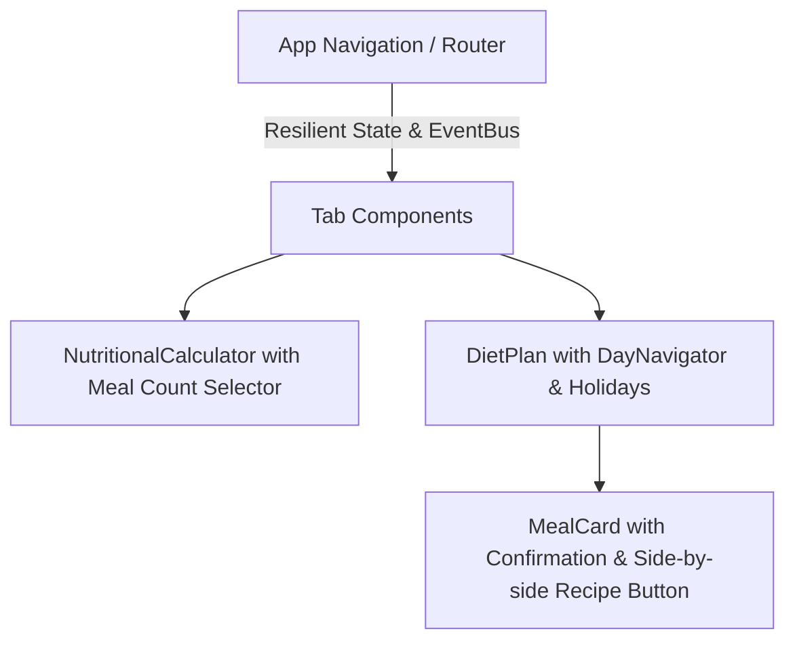

# UI/UX Enhancements and Resilience Architecture Plan

This document outlines the architectural plan for implementing the requested UI/UX optimizations, tab switching resilience, nutritional calculator meal count preference, DayNavigator holiday prominence, and MealCard button layout adjustments.

## Overview of Requirements

1. **Full-Screen Responsiveness & Dynamism**: Optimize container widths, padding, and flex layouts across devices in [`src/App.tsx`](src/App.tsx) and [`src/App.css`](src/App.css) to maximize screen space utilization.
2. **Tab Switching Resilience**: Address potential race conditions in tab switching buttons within [`src/App.tsx`](src/App.tsx) and [`src/utils/navigation.ts`](src/utils/navigation.ts), ensuring idempotent and robust navigation.
3. **Meal Count Selector in Nutritional Calculator**: Integrate a meal count preference selector (identical to [`src/components/DietPlan.tsx`](src/components/DietPlan.tsx)) into [`src/components/NutritionalCalculator.tsx`](src/components/NutritionalCalculator.tsx) and persist it in calculator preferences/state.
4. **Holiday Visibility in DayNavigator**: Make holidays in [`src/components/DayNavigator.tsx`](src/components/DayNavigator.tsx) immediately identifiable at a glance with distinct visual badges and color-coding.
5. **Recipe and Confirmation Buttons in MealCard**: Reposition the recipe button in [`src/components/dietPlan/MealCard.tsx`](src/components/dietPlan/MealCard.tsx) to sit right next to the meal confirmation button with balanced, compact sizing.

## Architecture & Component Flow

## Detailed Implementation Steps

### 1. UI Responsiveness & Dynamism
- Review main wrapper classes in [`src/App.tsx`](src/App.tsx) and major components.
- Ensure container constraints use fluid max-widths (`max-w-7xl` or full-width where appropriate) and responsive padding (`px-2 sm:px-4 md:px-6`).

### 2. Tab Switching Race Condition Fix
- Ensure [`src/App.tsx`](src/App.tsx) and [`src/utils/navigation.ts`](src/utils/navigation.ts) handle navigation events synchronously and safely without duplicate transition conflicts or stale refs.

### 3. Nutritional Calculator Meal Count Selector
- Import meal count preference handling or state sync in [`src/components/NutritionalCalculator.tsx`](src/components/NutritionalCalculator.tsx).
- Add the dropdown select for meals per day (`3`, `4`, `5`) with symbol indicators matching [`src/components/DietPlan.tsx`](src/components/DietPlan.tsx).

### 4. DayNavigator Holiday Prominence
- Update holiday rendering logic in [`src/components/DayNavigator.tsx`](src/components/DayNavigator.tsx) to display a distinct icon (`🎉` or `⭐`), distinct background tint, and tooltip/label indicating festive days.

### 5. MealCard Button Layout
- In [`src/components/dietPlan/MealCard.tsx`](src/components/dietPlan/MealCard.tsx), remove the recipe button from the top-right header and place it adjacent to the meal confirmation action button at the bottom of the card with synchronized sizing.

### 6. Verification
- Execute `npm run lint`, `npm test`, and Playwright E2E tests to verify correctness.
