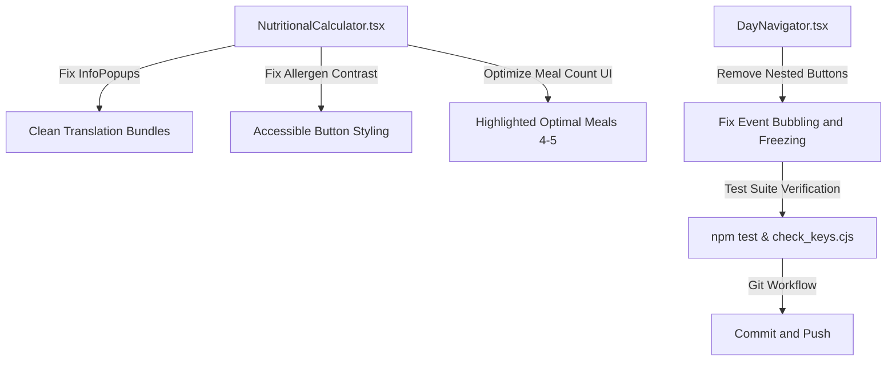

# Plan: UI Fixes, Accessibility Improvements, and DayNavigator Bugfix

## Objectives
1. **Fix Duplicate/Incorrect InfoPopups & Translation Cleanup**:
   - Inspect [`src/components/NutritionalCalculator.tsx`](src/components/NutritionalCalculator.tsx:1) for duplicate or misaligned InfoPopups (e.g., `diet_goal` vs `diet_phase`).
   - Clean up any unused translation keys across all locale JSON bundles (`public/locales/*/translation.json`).
   - Ensure all InfoPopups have coherent, precise translations.

2. **Improve Allergen Selection Accessibility**:
   - Fix contrast issues between selected allergen buttons (`bg-purple-600 text-white`) and their internal `InfoPopup` components in [`src/components/NutritionalCalculator.tsx`](src/components/NutritionalCalculator.tsx:409).

3. **Enhance "Meal Count" Selection**:
   - Reorganize or visually highlight the recommended meal counts (4-5 meals/day) in [`src/components/NutritionalCalculator.tsx`](src/components/NutritionalCalculator.tsx:358) so users are guided immediately to optimal options.

4. **Resolve DayNavigator Freezing Issue**:
   - Fix the invalid HTML structure in [`src/components/DayNavigator.tsx`](src/components/DayNavigator.tsx:107) where a `<button>` (quick edit note button) was nested inside another `<button>` (`DayCell` container button). Replace the outer container with a `div` and handle clicks on the day cell appropriately to prevent event bubbling/freezing.

5. **Testing & Version Control**:
   - Run `npm test` and `node check_keys.cjs` to ensure full test suite and key audits pass successfully.
   - Stage changes (`git add -A`), commit with semantic versioning commit message, and push to remote.

## Mermaid Architecture Diagram

